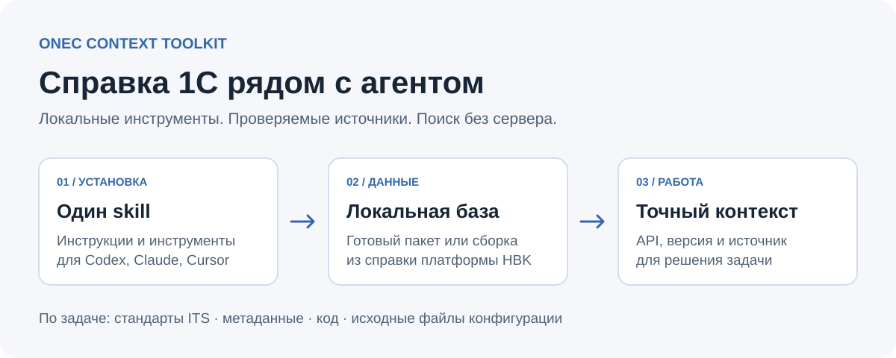
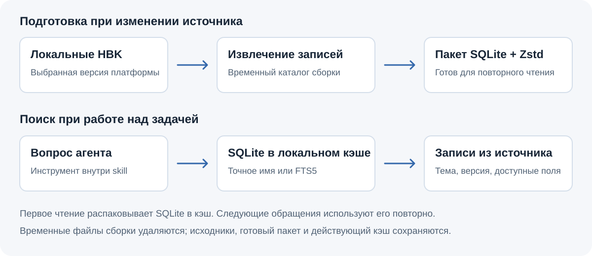

# Onec Context Toolkit



**Справка 1С и инструменты разработки внутри одного skill.**

Установите skill, укажите каталог платформы и задавайте агенту рабочие задачи.
Toolkit собирает локальную базу из HBK, выдаёт факты с версиями и подключает
метаданные, стандарты и код только тогда, когда они нужны.

Место toolkit среди соседних компонентов описано в [общей карте экосистемы](https://github.com/mussolene/1c_hbk_bsl#место-в-экосистеме). Toolkit отвечает за сборку и проверку пакетов из HBK и ConfigDump с привязкой к версии и конфигурации.

Для поиска не нужны Docker, Qdrant, Redis, сервер моделей или ключ API.
Нужен Python 3.11+. При первом запуске toolkit создаёт своё окружение и
устанавливает зависимости. Для полностью автономной работы подготовьте
окружение и пакет заранее.

## Быстрый старт

Из каталога скачанного репозитория:

```sh
python3 scripts/install_agent.py --agent codex
```

Затем напишите агенту:

> Используй onec-context. Платформа находится в /путь/к/платформе,
> версия 8.5.1.1343. Подготовь справку для этого проекта и проверь мой код.

Агент выполнит подготовку и поиск инструментами установленного skill.
Если новый skill ещё не появился в клиенте, откройте новую сессию.

Другие клиенты:

```sh
python3 scripts/install_agent.py --agent claude
python3 scripts/install_agent.py --agent cursor --workspace /путь/к/проекту
```

По умолчанию устанавливается один самостоятельный skill. Справочные материалы
и исполняемые инструменты находятся внутри. `--supplemental` дополнительно
устанавливает отдельные специализированные skills. Обновление той же командой
сохраняет подготовленное окружение и вложенный пакет справки.

## С готовой базой: сразу к работе

Сначала соберите пакет для выбранной версии:

```sh
python3 scripts/onec_context.py ensure \
  --workspace-root /путь/к/проекту \
  --need platform \
  --hbk-base /путь/к/платформе \
  --platform 8.5.1.1343

python3 scripts/onec_context.py resolve-packs \
  --workspace-root /путь/к/проекту --role platform --path-only
```

Передайте выведенный путь установщику:

```sh
python3 scripts/install_agent.py --agent codex --platform-pack /путь/к/platform.kb.db.zst
```

Skill получит собственную копию базы. Поиск больше не требует исходного HBK
или запущенного контейнера. Точная версия каждого результата остаётся видимой.
Сам HBK и материалы ITS не входят в публичный репозиторий.

## Поиск

Команды ниже выполняются из корня установленного skill или репозитория toolkit.
В другом рабочем каталоге укажите абсолютный путь к `scripts/onec_context.py`.
Поиск без пути к проекту читает `artifacts/platform.kb.db.zst` рядом со skill:

```sh
python3 scripts/onec_context.py query-kb \
  --q 'Структура.Вставить' --exact --version 8.5.1.1343 --json
```

Или по пакету конкретного проекта:

```sh
python3 scripts/onec_context.py query-kb \
  --workspace-root /путь/к/проекту --q 'Структура.Вставить' --exact --json
```

Результат содержит имя, тему, версии и доступные параметры, возвращаемое
значение и ограничения. `--detail full` возвращает исходную структурированную
запись. Поля источника сохраняются без обрезки; короткое описание может быть
сокращено с явным признаком. Без `--exact` выполняется полнотекстовый поиск,
если точного совпадения нет. Из вопроса выделяется полное имя `Тип.Метод`,
а для остальных формулировок используются значимые слова и поиск по началу слов.
Это лексический поиск FTS5, без модели эмбеддингов: найденные записи нужно
проверить на соответствие вопросу. По умолчанию возвращается
до пяти результатов. Отдельные примеры ищите с `--domain api_examples`;
`--detail full` не добавляет записи из других разделов и не возвращает исходный HTML.

Пакеты старого формата нужно пересобрать: новый поиск требует схему 2.
Отсутствие результата означает отсутствие подтверждения в выбранном пакете.

## Первый запуск и повторная работа



`ensure` проверяет источник и использует готовую справку, если байты HBK,
версия сборщика и параметры выбора не изменились. Промежуточная распаковка
удаляется. SQLite извлекается из архива один раз в локальный кэш и используется
повторно; `ONEC_CONTEXT_CACHE_DIR` позволяет выбрать каталог кэша.
Первое обращение включает распаковку SQLite, следующие обходятся без неё.
На диске остаются исходные HBK, сжатый пакет и несжатый SQLite в кэше.
Это разные объёмы: размер архива не равен общему потреблению диска.
Уборка временных каталогов работает при обычном завершении и обработке ошибок;
принудительное уничтожение процесса может оставить незавершённую сборку.

## Дополнительные слои

| Потребность | Подготовка | Чтение |
| --- | --- | --- |
| Стандарты ITS из локального каталога | `ensure --need standards --standards-dir ...` | `query-kb --role standards` |
| Реквизиты, формы, типы конфигурации | `ensure --need metadata --source-path ...` | `query-kb --role metadata` |
| Модули, методы, вызывающий код | `ensure --need code` | `query-code` |
| Точный XML и файлы конфигурации | `ensure --need full` | `query-config` |

Указывайте `--workspace-root` при работе с проектом. Для нескольких конфигураций
выбирайте `--target`. `resolve-packs` возвращает актуальные пути; их не нужно
угадывать. Стандарты и конфигурация имеют отдельные источники и не возникают
автоматически из справки платформы.

BSL Language Server и тесты проекта проверяют получившийся код. Toolkit
предоставляет контекст, но не заменяет эти проверки. OACS можно использовать
как существующую память проекта; для запуска toolkit он не требуется.
Автоматического адаптера OACS в toolkit сейчас нет.

## Инструменты и проверка

`python3 scripts/onec_context.py --help` показывает все команды.
Необязательный stdio MCP: `onec-context-mcp` после подготовки окружения.
Переносимый пакет для чтения: `export --workspace-root ... --archive`.
Он содержит выбранные пакеты, инструменты чтения и отдельную инструкцию.
В отличие от установленного toolkit, он не содержит сборщик и автоматическую
подготовку Python. Для Python до 3.14 рекомендуется модуль `zstandard`; в Python 3.14
доступен встроенный `compression.zstd`. Средство совместимости также поддерживает
установленный `zstd`.

`status` помогает диагностировать состояние, `ensure` подготавливает нужные
слои, `init` явно запускает сборку. Проверка изменений конфигурации не является
полным сравнением всех XML и BSL: после правок исходников выполняйте `init`
с нужным профилем, затем `verify`. Пакет платформы при неизменном источнике
может использоваться повторно.

Проверка реализации в изолированных временных каталогах:

```sh
python3 -m unittest discover -s tests -v
```

[Сценарии проверки](examples/proof-surface.md) ·
[Сценарии работы с конфигурацией](examples/live-codebase-proof.md) ·
[Команды](examples/commands.txt) ·
[Устройство проекта](AGENTS.md) ·
[Команды платформы](docs/1c-platform-cli.md)
